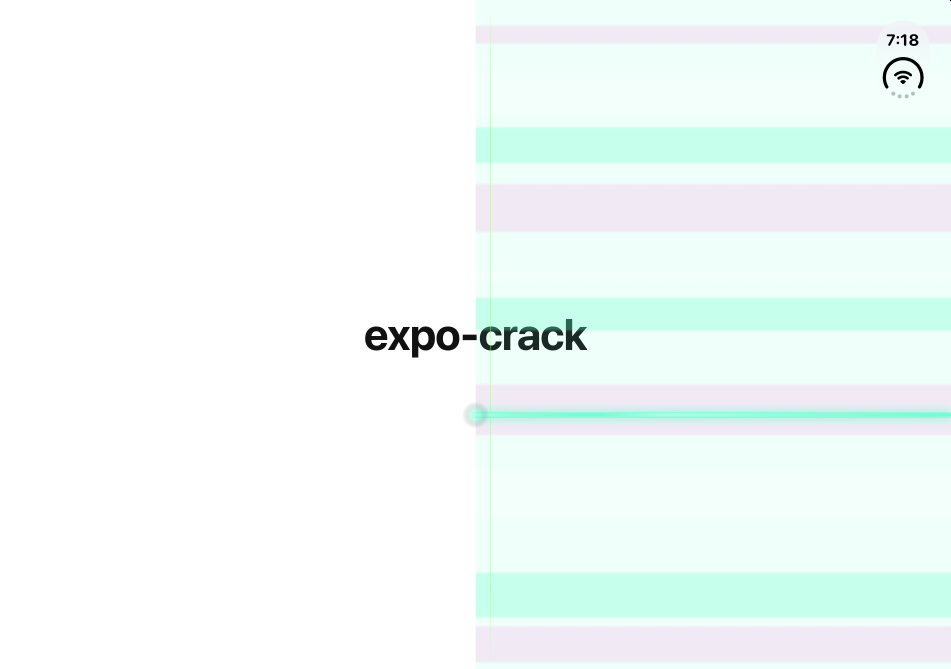
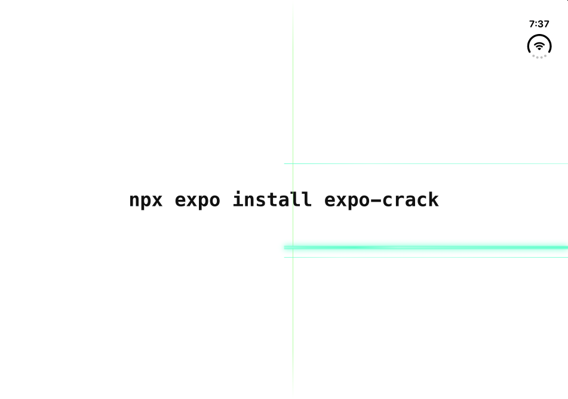

# expo-crack

The iPhone Duo green line glitch, as an Expo module.

Every new iPhone Duo seems to come with a bright green line across the right half of the inner display. Some people get it on day one, some after a week. Your app, built with Expo, has been missing it. Until now.

```sh
npx expo install expo-crack
```

Rebuild your app and that's it. The line is on by default. No code, no setup, no warranty.

<p align="center">
  
</p>

<p align="center">
  
</p>
<p align="center"><sub>Half open: the whole right panel gives up. Fold it flat and it calms down to the single line.</sub></p>

<p align="center">
  
  &nbsp;&nbsp;
  
</p>
<p align="center"><sub>At 100°: a second hairline. Closed: nothing, the line waits for you to open the phone.</sub></p>

## What you get

- A bright green line from the fold to the right edge, exactly where it belongs (62% down the screen), with a hairline a few millimetres under it.
- It flickers only while the hinge is moving. The rest of the time it holds perfectly still, like a real defect.
- On an iPhone Duo it only shows on the open inner display and hides while the phone is closed, like the real one. (It reads the hinge on iOS 27.1 and later.)
- It reacts to the hinge angle. Around half-open (118° to 142°) the whole right panel glitches with rolling bands. Between 60° and 118° and between 142° and 165° a hairline second line shows up. Between 95° and 150° a faint vertical line appears just right of the hinge. Fully open, you get the classic single line.
- It floats above everything: modals, alerts, your onboarding, your paywall.
- It never eats a touch. Your users can keep tapping through it, like on the real thing.
- iOS, Android and web. The line does not care how much you paid for the device. (tvOS builds compile, but get no line. Nobody folds a TV.)

## Usage

You don't need any code. But if you want control:

```ts
import Crack from 'expo-crack';

Crack.disable(); // coward
Crack.enable(); // welcome back

Crack.toggle(); // returns the new state
Crack.isEnabled();

// Restyle it. Only the options you pass change.
Crack.configure({
  y: 0.62, // vertical position, as a fraction of the screen height
  thickness: 3, // in points
  color: '#61FFCC', // #RGB, #RRGGBB or #RRGGBBAA
  side: 'right', // 'left' | 'right' | 'full'
  crease: true, // also draw the faint vertical line along the fold
  flicker: true, // flicker while the hinge moves
  hideWhenFolded: true, // iPhone Duo: show it on the open inner display only
  reactToHinge: true, // iPhone Duo: extra lines and the panel glitch at some hinge angles
});

Crack.reset(); // factory settings
```

Named exports work too: `import { enable, disable, configure } from 'expo-crack'`.

### Start without the line

Add the config plugin with `autoStart: false` and the app launches clean. You can still call `Crack.enable()` later, for example on a user's birthday.

```json
{
  "expo": {
    "plugins": [["expo-crack", { "autoStart": false }]]
  }
}
```

## How it works

- **iOS**: a transparent `UIWindow` above the alert level, attached to the active scene. Touches pass through it. The line is a few `CALayer`s with a glow and a banded gradient, nothing is rendered per frame.
- **Android**: a `View` added to the activity's decor view with a very large elevation.
- **Web**: a fixed, pointer-transparent `div`.

The glitch turns itself on at launch through an `ExpoAppDelegateSubscriber` on iOS and a `ReactActivityLifecycleListener` on Android, so it is there before your JavaScript runs.

## FAQ

**Does it work in Expo Go?**
No. It is a native module, so you need a development build (`npx expo run:ios`, `npx expo run:android` or EAS Build). Without the native code the JavaScript API logs a warning and does nothing.

**Will it work on a device that is not an iPhone Duo?**
Yes. The line starts in the middle of the screen and goes to the right edge, which looks just as wrong on an iPhone, an iPad or a Pixel Fold.

**Why would anyone install this?**
Engagement.

## Example app

The `example` folder is an SDK 58 app that is nothing but a white screen with a title. The line comes from installing the package, no code.

To run it on the iPhone Duo simulator you need Xcode 27.1 or later (that is where the Duo and its hinge live).

```sh
git clone https://github.com/davidmokos/expo-crack.git
cd expo-crack && npm install          # also builds the module
cd example && npm install
npx expo run:ios --device "iPhone Duo"
```

Fold and unfold the simulator with its hinge controls, or from a terminal: `npx agent-device@latest fold half-open` (also `open`, `closed`, or `--keyframes` for exact angles).

No Mac with Xcode 27? `eas build -p ios --profile development`, then `eas simulator:start --device "iPhone Duo" --build-id <id>` runs it on an EAS cloud simulator.

## License

MIT. Not affiliated with Apple. No Duos were harmed.
