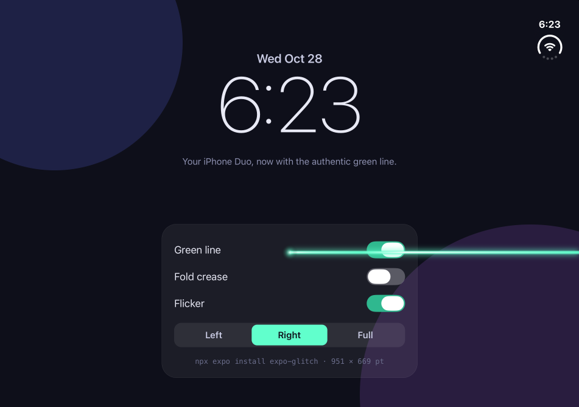
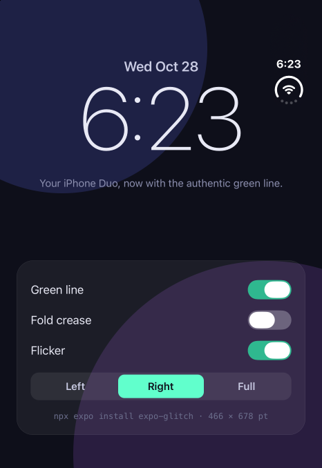
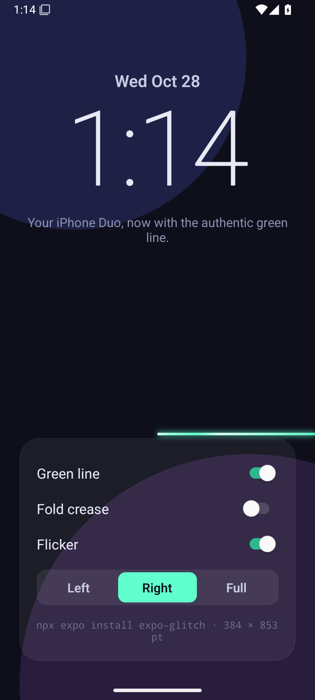

# expo-glitch

The iPhone Duo green line glitch, as an Expo module.

Every new iPhone Duo seems to come with a bright green line across the right half of the inner display. Some people get it on day one, some after a week. Your app, built with Expo, has been missing it. Until now.

```sh
npx expo install expo-glitch
```

Rebuild your app and that's it. The line is on by default. No code, no setup, no warranty.

<p align="center">
  
</p>

<p align="center">
  
  &nbsp;&nbsp;
  
</p>
<p align="center"><sub>Closed Duo on the left: the line waits for you to open the phone. Android on the right: no hinge, no mercy.</sub></p>

## What you get

- A bright, slightly flickering green line from the fold to the right edge, exactly where it belongs (62% down the screen).
- On an iPhone Duo it only shows on the open inner display and hides while the phone is closed, like the real one. (It reads the hinge on iOS 27.1 and later.)
- It floats above everything: modals, alerts, your onboarding, your paywall.
- It never eats a touch. Your users can keep tapping through it, like on the real thing.
- iOS, Android and web. The line does not care how much you paid for the device. (tvOS builds compile, but get no line. Nobody folds a TV.)

## Usage

You don't need any code. But if you want control:

```ts
import Glitch from 'expo-glitch';

Glitch.disable(); // coward
Glitch.enable(); // welcome back

Glitch.toggle(); // returns the new state
Glitch.isEnabled();

// Restyle it. Only the options you pass change.
Glitch.configure({
  y: 0.62, // vertical position, as a fraction of the screen height
  thickness: 3, // in points
  color: '#61FFCC', // #RGB, #RRGGBB or #RRGGBBAA
  side: 'right', // 'left' | 'right' | 'full'
  crease: true, // also draw the faint vertical line along the fold
  flicker: true, // let it flicker a little
  hideWhenFolded: true, // iPhone Duo: show it on the open inner display only
});

Glitch.reset(); // factory settings
```

Named exports work too: `import { enable, disable, configure } from 'expo-glitch'`.

### Start without the line

Add the config plugin with `autoStart: false` and the app launches clean. You can still call `Glitch.enable()` later, for example on a user's birthday.

```json
{
  "expo": {
    "plugins": [["expo-glitch", { "autoStart": false }]]
  }
}
```

## How it works

- **iOS**: a transparent `UIWindow` above the alert level, attached to the active scene. Touches pass through it. The line is a few `CALayer`s with a glow and a banded gradient, nothing is rendered per frame.
- **Android**: a `View` added to the activity's decor view with a very large elevation.
- **Web**: a fixed, pointer-transparent `div`.

The glitch turns itself on at launch through an `ExpoAppDelegateSubscriber` on iOS and a `ReactActivityLifecycleListener` on Android, so it is there before your JavaScript runs.

## FAQ

**Does it work in Expo Go?**
No. It is a native module, so you need a development build (`npx expo run:ios`, `npx expo run:android` or EAS Build). Without the native code the JavaScript API logs a warning and does nothing.

**Will it work on a device that is not an iPhone Duo?**
Yes. The line starts in the middle of the screen and goes to the right edge, which looks just as wrong on an iPhone, an iPad or a Pixel Fold.

**Why would anyone install this?**
Engagement.

## Example app

The `example` folder is an SDK 58 app that shows the line on a lock-screen-style clock with a few toggles.

```sh
cd example
npm install
npx expo run:ios        # local simulator
eas build -p ios --profile preview   # simulator build on EAS, works with `eas simulator:start --device "iPhone Duo"`
```

## License

MIT. Not affiliated with Apple. No Duos were harmed.
